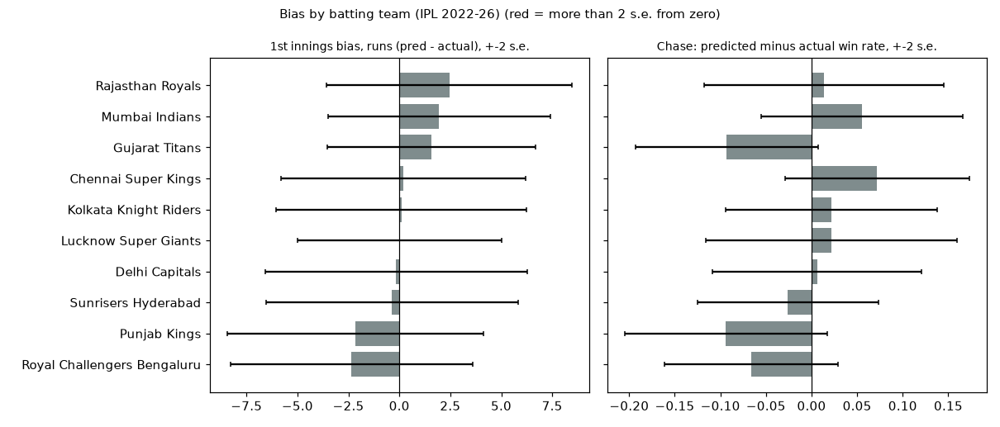
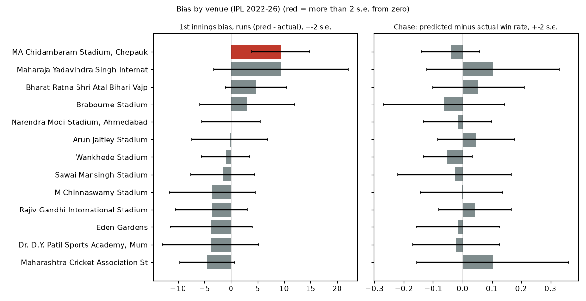

# Where the in-play model is good or bad (error analysis)

Model: **v1 ens-G1** (50/50 of the direct LightGBM model G1 and the ball simulator sim-B). Baseline: resource-ipl (a simple resource-table model). Only out-of-sample predictions are used: IPL 2022-25 (each season predicted by models trained on earlier seasons), IPL 2026 (models trained up to 2025), and non-IPL men's leagues from 2026 (the fresh holdout). Generated by `src/cricket_analytics/ml/error_report.py`.

How to read the tables:
- **bias** = predicted minus actual, in runs (first innings). Positive = the model guessed too high.
- **gap** = average predicted chase-win chance minus how often the chase really won. Negative = the model under-rates the chasing team.
- **se** = bootstrap standard error (re-draw the matches many times to see how much the number wobbles). **FLAG** = more than 2 s.e. away from zero (and at least 8 matches). With about 20 groups in a table, about 1 flag is just luck.
- `n 1st` / `n ch` = number of matches (not states). `%+-20` = share of first-innings forecasts within 20 runs. `right%` = share of chase states where the favourite won.
- Numbers pool the 6, 10 and 15-over checkpoints (a match counts up to 3 times; the s.e. resamples whole matches so this is handled). The 0-over checkpoint is in the phase table.
- `base MAE` / `base logloss` = baseline resource-ipl on the same states. Log loss: lower is better; 0.693 = coin flip.

Sample: IPL 2022-26, 355 matches with a first innings, 353 with a chase; reduced (rain) matches excluded.

## 1. By batting team (IPL 2022-26, 6/10/15 overs pooled)
First-innings columns use the team batting first; chase columns use the chasing team.

| batting_team | n 1st | MAE | base MAE | bias | bias se | %+-20 | flag | n ch | right% | pred | actual | gap | gap se | ch logloss | base logloss | ch flag |
|---|---|---|---|---|---|---|---|---|---|---|---|---|---|---|---|---|
| Chennai Super Kings | 41 | 15.81 | 17.43 | 0.18 | 3.00 | 72.36 |  | 29 | 87.21 | 0.53 | 0.45 | 0.07 | 0.05 | 0.28 | 0.26 |  |
| Delhi Capitals | 27 | 14.43 | 16.91 | -0.15 | 3.21 | 76.54 |  | 42 | 80.49 | 0.45 | 0.44 | 0.01 | 0.06 | 0.43 | 0.52 |  |
| Gujarat Titans | 33 | 13.52 | 15.03 | 1.57 | 2.56 | 76.77 |  | 42 | 81.60 | 0.55 | 0.64 | -0.09 | 0.05 | 0.41 | 0.51 |  |
| Kolkata Knight Riders | 32 | 16.60 | 19.53 | 0.11 | 3.07 | 67.71 |  | 33 | 83.87 | 0.55 | 0.53 | 0.02 | 0.06 | 0.44 | 0.41 |  |
| Lucknow Super Giants | 39 | 14.31 | 15.29 | 0.01 | 2.51 | 73.50 |  | 30 | 80.90 | 0.46 | 0.44 | 0.02 | 0.07 | 0.55 | 0.65 |  |
| Mumbai Indians | 31 | 13.49 | 15.35 | 1.96 | 2.72 | 79.57 |  | 40 | 76.27 | 0.50 | 0.44 | 0.06 | 0.06 | 0.43 | 0.45 |  |
| Punjab Kings | 35 | 17.69 | 21.72 | -2.16 | 3.14 | 67.31 |  | 34 | 78.43 | 0.49 | 0.59 | -0.09 | 0.06 | 0.41 | 0.64 |  |
| Rajasthan Royals | 38 | 15.51 | 16.17 | 2.45 | 3.01 | 71.05 |  | 36 | 76.19 | 0.54 | 0.52 | 0.01 | 0.07 | 0.49 | 0.56 |  |
| Royal Challengers Bengaluru | 41 | 16.03 | 19.08 | -2.35 | 2.97 | 73.17 |  | 33 | 88.30 | 0.58 | 0.65 | -0.07 | 0.05 | 0.31 | 0.39 |  |
| Sunrisers Hyderabad | 38 | 19.13 | 21.89 | -0.37 | 3.09 | 60.53 |  | 34 | 88.66 | 0.43 | 0.45 | -0.03 | 0.05 | 0.32 | 0.41 |  |

## 2. By venue (IPL venues with 10 or more matches in 2022-26)

| venue | n 1st | MAE | base MAE | bias | bias se | %+-20 | flag | n ch | right% | pred | actual | gap | gap se | ch logloss | base logloss | ch flag |
|---|---|---|---|---|---|---|---|---|---|---|---|---|---|---|---|---|
| Arun Jaitley Stadium | 26 | 14.76 | 18.36 | -0.19 | 3.58 | 74.36 |  | 25 | 87.50 | 0.55 | 0.50 | 0.05 | 0.07 | 0.37 | 0.41 |  |
| Bharat Ratna Shri Atal Bihari Vajpayee Ekana Cricket Stadium, Lucknow | 27 | 14.60 | 16.87 | 4.69 | 2.90 | 76.54 |  | 26 | 74.36 | 0.67 | 0.62 | 0.06 | 0.08 | 0.52 | 0.59 |  |
| Brabourne Stadium | 16 | 16.63 | 16.28 | 3.04 | 4.49 | 72.92 |  | 16 | 66.67 | 0.40 | 0.47 | -0.06 | 0.10 | 0.54 | 0.58 |  |
| Dr. D.Y. Patil Sports Academy, Mumbai | 20 | 16.32 | 16.36 | -3.87 | 4.54 | 65.00 |  | 20 | 88.33 | 0.48 | 0.50 | -0.02 | 0.07 | 0.38 | 0.31 |  |
| Eden Gardens | 27 | 18.42 | 22.47 | -3.71 | 3.88 | 62.96 |  | 27 | 82.50 | 0.46 | 0.47 | -0.01 | 0.07 | 0.41 | 0.58 |  |
| M Chinnaswamy Stadium | 23 | 17.29 | 19.76 | -3.56 | 4.06 | 68.12 |  | 23 | 80.88 | 0.51 | 0.51 | -0.00 | 0.07 | 0.40 | 0.49 |  |
| MA Chidambaram Stadium, Chepauk | 31 | 15.64 | 13.32 | 9.40 | 2.75 | 73.12 | FLAG | 31 | 90.11 | 0.56 | 0.60 | -0.04 | 0.05 | 0.29 | 0.40 |  |
| Maharaja Yadavindra Singh International Cricket Stadium | 10 | 19.94 | 20.09 | 9.40 | 6.34 | 58.62 |  | 10 | 89.29 | 0.57 | 0.46 | 0.10 | 0.11 | 0.64 | 0.51 |  |
| Maharashtra Cricket Association Stadium, Pune | 13 | 11.19 | 10.87 | -4.49 | 2.61 | 89.74 |  | 13 | 64.86 | 0.35 | 0.24 | 0.10 | 0.13 | 0.58 | 0.55 |  |
| Narendra Modi Stadium, Ahmedabad | 35 | 15.27 | 17.61 | -0.01 | 2.73 | 72.38 |  | 35 | 82.00 | 0.46 | 0.48 | -0.02 | 0.06 | 0.41 | 0.50 |  |
| Rajiv Gandhi International Stadium, Uppal | 25 | 16.04 | 20.55 | -3.70 | 3.39 | 72.00 |  | 25 | 82.19 | 0.51 | 0.47 | 0.04 | 0.06 | 0.32 | 0.33 |  |
| Sawai Mansingh Stadium | 21 | 11.98 | 17.18 | -1.55 | 3.03 | 77.78 |  | 21 | 68.85 | 0.55 | 0.57 | -0.03 | 0.10 | 0.54 | 0.70 |  |
| Wankhede Stadium | 48 | 14.56 | 17.23 | -1.02 | 2.27 | 73.61 |  | 48 | 85.82 | 0.52 | 0.57 | -0.05 | 0.04 | 0.34 | 0.39 |  |

### Non-IPL leagues, 2026 fresh set (v1 ens; 316 first innings, 311 chases; no baseline cached)

By competition:

| competition | n 1st | MAE | bias | bias se | %+-20 | flag | n ch | right% | pred | actual | gap | gap se | ch logloss | ch flag |
|---|---|---|---|---|---|---|---|---|---|---|---|---|---|---|
| bbl | 24 | 17.48 | 1.87 | 3.94 | 55.56 |  | 24 | 80.00 | 0.62 | 0.63 | -0.01 | 0.07 | 0.43 |  |
| blast | 111 | 15.08 | 0.70 | 1.70 | 69.37 |  | 109 | 78.32 | 0.50 | 0.48 | 0.01 | 0.03 | 0.43 |  |
| bpl | 28 | 17.49 | 5.16 | 3.60 | 62.65 |  | 27 | 83.12 | 0.62 | 0.57 | 0.05 | 0.06 | 0.32 |  |
| cpl | 33 | 19.39 | 4.18 | 3.79 | 60.20 |  | 32 | 79.55 | 0.61 | 0.68 | -0.07 | 0.06 | 0.35 |  |
| ilt20 | 3 | 14.46 | 11.18 | 6.88 | 66.67 |  | 3 | 100.00 | 0.44 | 0.33 | 0.10 | 0.07 | 0.17 |  |
| lpl | 22 | 15.60 | -8.50 | 3.32 | 68.18 | FLAG | 22 | 87.88 | 0.33 | 0.36 | -0.03 | 0.06 | 0.30 |  |
| mlc | 33 | 18.24 | 6.29 | 3.17 | 62.63 |  | 33 | 74.75 | 0.57 | 0.58 | -0.00 | 0.06 | 0.51 |  |
| psl | 42 | 15.06 | 4.12 | 2.92 | 74.60 |  | 42 | 86.89 | 0.60 | 0.66 | -0.06 | 0.05 | 0.32 |  |
| sa20 | 20 | 17.00 | -1.15 | 4.53 | 66.67 |  | 19 | 79.63 | 0.45 | 0.50 | -0.05 | 0.07 | 0.35 |  |

By venue (6 or more matches; lower cut-off than the IPL because the sample is small):

| venue | n 1st | MAE | bias | bias se | %+-20 | flag | n ch | right% | pred | actual | gap | gap se | ch logloss | ch flag |
|---|---|---|---|---|---|---|---|---|---|---|---|---|---|---|
| County Ground, Bristol | 6 | 16.44 | 5.35 | 7.48 | 61.11 |  | 6 | 81.25 | 0.47 | 0.31 | 0.16 | 0.12 | 0.35 |  |
| County Ground, Chelmsford | 6 | 21.91 | -4.39 | 9.75 | 44.44 |  | 6 | 100.00 | 0.62 | 0.67 | -0.04 | 0.07 | 0.17 |  |
| County Ground, Hove | 6 | 17.10 | 2.40 | 8.17 | 55.56 |  | 6 | 83.33 | 0.51 | 0.67 | -0.15 | 0.10 | 0.30 |  |
| County Ground, New Road | 6 | 11.80 | -1.19 | 5.88 | 77.78 |  | 6 | 81.25 | 0.40 | 0.38 | 0.03 | 0.13 | 0.41 |  |
| Edgbaston | 9 | 12.11 | -2.56 | 4.42 | 74.07 |  | 9 | 77.78 | 0.40 | 0.33 | 0.06 | 0.12 | 0.45 |  |
| Gaddafi Stadium, Lahore | 20 | 12.14 | 3.22 | 3.01 | 85.00 |  | 20 | 83.05 | 0.64 | 0.75 | -0.11 | 0.08 | 0.44 |  |
| Grace Road, Leicester | 6 | 14.02 | 5.15 | 5.92 | 77.78 |  | 6 | 82.35 | 0.44 | 0.29 | 0.14 | 0.12 | 0.30 |  |
| Grand Prairie Stadium, Dallas | 14 | 15.96 | 4.44 | 3.37 | 71.43 |  | 14 | 85.71 | 0.56 | 0.64 | -0.09 | 0.08 | 0.37 |  |
| Headingley | 7 | 14.07 | -3.11 | 5.01 | 76.19 |  | 7 | 65.00 | 0.15 | 0.45 | -0.29 | 0.17 | 1.02 |  |
| Kensington Oval, Bridgetown | 9 | 22.89 | 10.90 | 6.69 | 46.15 |  | 8 | 77.27 | 0.72 | 0.86 | -0.14 | 0.10 | 0.29 |  |
| Knight Riders Cricket Ground, Pomona | 7 | 20.64 | 17.04 | 6.75 | 57.14 |  | 7 | 61.90 | 0.67 | 0.71 | -0.04 | 0.18 | 0.61 |  |
| National Stadium, Karachi | 22 | 17.72 | 4.94 | 4.14 | 65.15 |  | 22 | 90.48 | 0.56 | 0.57 | -0.01 | 0.05 | 0.20 |  |
| Oakland Coliseum,Oakland | 12 | 19.50 | 2.17 | 5.97 | 55.56 |  | 12 | 69.44 | 0.53 | 0.42 | 0.11 | 0.11 | 0.62 |  |
| Rangiri Dambulla International Stadium | 8 | 10.04 | -6.42 | 3.21 | 91.67 | FLAG | 8 | 91.67 | 0.24 | 0.12 | 0.11 | 0.06 | 0.19 |  |
| Shere Bangla National Stadium | 10 | 16.82 | 6.73 | 5.48 | 63.33 |  | 10 | 80.00 | 0.57 | 0.50 | 0.07 | 0.10 | 0.35 |  |
| Sophia Gardens | 6 | 14.26 | 2.96 | 6.03 | 72.22 |  | 6 | 76.47 | 0.64 | 0.65 | -0.01 | 0.14 | 0.39 |  |
| St Lawrence Ground, Canterbury | 6 | 16.95 | 14.67 | 6.95 | 66.67 |  | 6 | 53.33 | 0.61 | 0.80 | -0.19 | 0.16 | 0.59 |  |
| Sylhet International Cricket Stadium | 18 | 17.88 | 4.26 | 4.44 | 62.26 |  | 17 | 85.11 | 0.66 | 0.62 | 0.04 | 0.07 | 0.30 |  |
| The Cooper Associates County Ground, Taunton | 6 | 19.11 | -5.41 | 8.86 | 55.56 |  | 6 | 64.71 | 0.44 | 0.65 | -0.20 | 0.18 | 0.69 |  |
| The Rose Bowl | 7 | 15.89 | -5.33 | 6.02 | 66.67 |  | 7 | 76.19 | 0.52 | 0.43 | 0.09 | 0.13 | 0.39 |  |
| Trent Bridge | 7 | 11.54 | 7.09 | 4.74 | 85.71 |  | 7 | 71.43 | 0.78 | 0.57 | 0.21 | 0.13 | 0.49 |  |

## 3. By season and by phase checkpoint

By season (6/10/15 pooled):

| season_year | n 1st | MAE | base MAE | bias | bias se | %+-20 | flag | n ch | right% | pred | actual | gap | gap se | ch logloss | base logloss | ch flag |
|---|---|---|---|---|---|---|---|---|---|---|---|---|---|---|---|---|
| 2022 | 74 | 15.12 | 15.45 | -1.58 | 2.00 | 73.42 |  | 74 | 79.07 | 0.46 | 0.49 | -0.03 | 0.04 | 0.45 | 0.44 |  |
| 2023 | 71 | 15.18 | 16.96 | -1.76 | 2.02 | 74.18 |  | 71 | 76.19 | 0.43 | 0.45 | -0.01 | 0.05 | 0.51 | 0.62 |  |
| 2024 | 70 | 17.08 | 20.22 | -1.39 | 2.21 | 68.57 |  | 70 | 83.25 | 0.51 | 0.50 | 0.01 | 0.04 | 0.38 | 0.45 |  |
| 2025 | 69 | 14.51 | 17.86 | 2.72 | 2.08 | 75.24 |  | 68 | 82.00 | 0.56 | 0.50 | 0.05 | 0.04 | 0.42 | 0.46 |  |
| 2026 | 71 | 16.75 | 19.11 | 2.53 | 2.15 | 66.67 |  | 70 | 89.22 | 0.57 | 0.64 | -0.07 | 0.03 | 0.28 | 0.45 | FLAG |

By checkpoint (all IPL 2022-26):

| cp | n 1st | MAE | base MAE | bias | bias se | %+-20 | flag | n ch | right% | pred | actual | gap | gap se | ch logloss | base logloss | ch flag |
|---|---|---|---|---|---|---|---|---|---|---|---|---|---|---|---|---|
| 0 ov | 355 | 27.51 | 32.44 | -2.75 | 1.79 | 44.23 |  | 353 | 71.95 | 0.51 | 0.52 | -0.01 | 0.02 | 0.56 | 0.77 |  |
| 6 ov | 355 | 20.39 | 23.86 | -0.05 | 1.34 | 59.72 |  | 353 | 79.60 | 0.51 | 0.52 | -0.01 | 0.02 | 0.47 | 0.58 |  |
| 10 ov | 355 | 16.50 | 18.49 | 0.31 | 1.09 | 68.17 |  | 348 | 80.17 | 0.51 | 0.52 | -0.01 | 0.02 | 0.44 | 0.51 |  |
| 15 ov | 354 | 10.28 | 11.31 | -0.03 | 0.71 | 87.01 |  | 331 | 86.10 | 0.50 | 0.51 | -0.01 | 0.02 | 0.32 | 0.35 |  |

Season x checkpoint:

| season | cp | n 1st | MAE | bias | flag | n ch | pred | actual | gap | ch flag |
|---|---|---|---|---|---|---|---|---|---|---|
| 2022 | 0 ov | 74 | 23.47 | -1.88 |  | 74 | 0.52 | 0.50 | 0.01 |  |
| 2022 | 6 ov | 74 | 19.52 | -1.21 |  | 74 | 0.47 | 0.50 | -0.03 |  |
| 2022 | 10 ov | 74 | 15.80 | -1.73 |  | 73 | 0.47 | 0.49 | -0.02 |  |
| 2022 | 15 ov | 74 | 10.04 | -1.81 |  | 68 | 0.44 | 0.49 | -0.04 |  |
| 2023 | 0 ov | 71 | 25.76 | -8.26 | FLAG | 71 | 0.45 | 0.45 | -0.00 |  |
| 2023 | 6 ov | 71 | 18.60 | -2.70 |  | 71 | 0.43 | 0.45 | -0.02 |  |
| 2023 | 10 ov | 71 | 16.63 | -1.11 |  | 71 | 0.45 | 0.45 | -0.01 |  |
| 2023 | 15 ov | 71 | 10.31 | -1.48 |  | 68 | 0.42 | 0.44 | -0.02 |  |
| 2024 | 0 ov | 70 | 30.36 | -1.45 |  | 70 | 0.52 | 0.51 | 0.00 |  |
| 2024 | 6 ov | 70 | 23.90 | -1.23 |  | 70 | 0.54 | 0.51 | 0.02 |  |
| 2024 | 10 ov | 70 | 16.96 | -0.83 |  | 68 | 0.51 | 0.50 | 0.01 |  |
| 2024 | 15 ov | 70 | 10.37 | -2.10 |  | 65 | 0.47 | 0.48 | -0.01 |  |
| 2025 | 0 ov | 69 | 27.49 | -1.70 |  | 68 | 0.53 | 0.51 | 0.01 |  |
| 2025 | 6 ov | 69 | 19.32 | 3.74 |  | 68 | 0.54 | 0.51 | 0.03 |  |
| 2025 | 10 ov | 69 | 15.39 | 3.46 |  | 67 | 0.55 | 0.51 | 0.04 |  |
| 2025 | 15 ov | 68 | 8.74 | 0.93 |  | 65 | 0.58 | 0.49 | 0.09 | FLAG |
| 2026 | 0 ov | 71 | 30.66 | -0.45 |  | 70 | 0.54 | 0.64 | -0.10 | FLAG |
| 2026 | 6 ov | 71 | 20.65 | 1.26 |  | 70 | 0.56 | 0.64 | -0.08 | FLAG |
| 2026 | 10 ov | 71 | 17.73 | 1.92 |  | 69 | 0.57 | 0.64 | -0.06 |  |
| 2026 | 15 ov | 71 | 11.89 | 4.42 | FLAG | 65 | 0.58 | 0.65 | -0.07 | FLAG |

## 4. By type of match (6/10/15 pooled)

Target bucket (the target is known only after the first innings ends, so the chase columns are a fair split; the first-innings columns are a look-back):

| tbucket | n 1st | MAE | base MAE | bias | bias se | %+-20 | flag | n ch | right% | pred | actual | gap | gap se | ch logloss | base logloss | ch flag |
|---|---|---|---|---|---|---|---|---|---|---|---|---|---|---|---|---|
| 160-189 | 109 | 12.81 | 11.74 | 5.24 | 1.29 | 80.73 | FLAG | 108 | 80.82 | 0.58 | 0.62 | -0.04 | 0.03 | 0.43 | 0.52 |  |
| 190-219 | 113 | 13.17 | 18.49 | -7.31 | 1.25 | 77.88 | FLAG | 113 | 76.11 | 0.38 | 0.37 | 0.01 | 0.04 | 0.48 | 0.58 |  |
| 220+ | 59 | 20.15 | 31.02 | -16.02 | 1.90 | 59.32 | FLAG | 59 | 89.20 | 0.27 | 0.22 | 0.04 | 0.03 | 0.28 | 0.35 |  |
| <160 | 74 | 20.43 | 15.56 | 16.67 | 1.76 | 58.37 | FLAG | 73 | 86.93 | 0.82 | 0.85 | -0.04 | 0.04 | 0.36 | 0.38 |  |

First-innings scoring band (by the FINAL total; this is hindsight, so a model that guesses near the average always looks 'too low' for big scores and 'too high' for small ones. Read it as how much the model shrinks toward the middle, not as a fixable bias):

| band | n 1st | MAE | base MAE | bias | bias se | %+-20 | flag |
|---|---|---|---|---|---|---|---|
| 160-189 | 106 | 12.57 | 11.77 | 4.13 | 1.22 | 81.76 | FLAG |
| 190-219 | 112 | 13.37 | 18.80 | -7.22 | 1.28 | 77.38 | FLAG |
| 220+ | 56 | 20.02 | 31.09 | -16.70 | 1.97 | 59.52 | FLAG |
| <160 | 81 | 20.17 | 15.50 | 16.53 | 1.63 | 58.68 | FLAG |

Toss decision (toss winner chose to bat or field):

| toss_bat | n 1st | MAE | base MAE | bias | bias se | %+-20 | flag | n ch | right% | pred | actual | gap | gap se | ch logloss | base logloss | ch flag |
|---|---|---|---|---|---|---|---|---|---|---|---|---|---|---|---|---|
| toss winner bats first | 79 | 16.38 | 18.59 | 3.62 | 2.05 | 71.73 |  | 79 | 77.39 | 0.55 | 0.54 | 0.01 | 0.04 | 0.51 | 0.59 |  |
| toss winner fields first | 276 | 15.54 | 17.69 | -0.94 | 1.02 | 71.58 |  | 274 | 83.17 | 0.49 | 0.51 | -0.02 | 0.02 | 0.38 | 0.45 |  |

Playoffs (last 4 matches of each season, by date) vs league games:

| stage | n 1st | MAE | base MAE | bias | bias se | %+-20 | flag | n ch | right% | pred | actual | gap | gap se | ch logloss | base logloss | ch flag |
|---|---|---|---|---|---|---|---|---|---|---|---|---|---|---|---|---|
| league | 335 | 15.62 | 17.89 | -0.22 | 0.94 | 71.94 |  | 333 | 81.15 | 0.51 | 0.52 | -0.01 | 0.02 | 0.41 | 0.49 |  |
| playoffs (last 4) | 20 | 17.53 | 17.87 | 5.06 | 4.65 | 66.10 |  | 20 | 94.64 | 0.53 | 0.52 | 0.01 | 0.06 | 0.29 | 0.34 |  |

Day vs night: not derivable (the data has no start time), skipped.

## 5. Biggest misses

Top 10 first-innings misses at 10 overs (IPL 2022-26; miss = predicted minus actual):

| date | batting | venue | predicted | actual | miss |
|---|---|---|---|---|---|
| 2022-04-12 | Chennai Super Kings | Dr. D.Y. Patil Sports Academy, Mumbai | 149 | 216 | -67 |
| 2026-04-19 | Rajasthan Royals | Eden Gardens | 210 | 155 | 55 |
| 2026-05-26 | Royal Challengers Bengaluru | HPCA Stadium, Dharamsala | 202 | 254 | -52 |
| 2025-04-11 | Chennai Super Kings | MA Chidambaram Stadium, Chepauk | 154 | 103 | 51 |
| 2022-04-20 | Punjab Kings | Brabourne Stadium | 165 | 115 | 50 |
| 2026-05-03 | Sunrisers Hyderabad | Rajiv Gandhi International Stadium, Uppal | 215 | 165 | 50 |
| 2026-04-25 | Delhi Capitals | Arun Jaitley Stadium | 216 | 264 | -48 |
| 2024-04-17 | Gujarat Titans | Narendra Modi Stadium, Ahmedabad | 136 | 89 | 47 |
| 2025-03-30 | Sunrisers Hyderabad | Dr. Y.S. Rajasekhara Reddy ACA-VDCA Cricket Stadium, Visakhapatnam | 210 | 163 | 47 |
| 2026-04-05 | Royal Challengers Bengaluru | M Chinnaswamy Stadium | 204 | 250 | -46 |

Top 10 most confident wrong chase calls (one per match; the most confident wrong state among 0/6/10/15 overs):

| date | match | target | at | p(chase wins) | chase actually |
|---|---|---|---|---|---|
| 2025-04-15 | Punjab Kings v Kolkata Knight Riders | 112 | 6 ov | 0.996 | lost |
| 2023-04-22 | Gujarat Titans v Lucknow Super Giants | 136 | 10 ov | 0.977 | lost |
| 2023-04-10 | Royal Challengers Bengaluru v Lucknow Super Giants | 213 | 6 ov | 0.032 | won |
| 2023-04-16 | Gujarat Titans v Rajasthan Royals | 178 | 10 ov | 0.072 | won |
| 2022-03-28 | Lucknow Super Giants v Gujarat Titans | 159 | 15 ov | 0.094 | won |
| 2023-05-01 | Royal Challengers Bengaluru v Lucknow Super Giants | 127 | 0 ov | 0.893 | lost |
| 2023-05-13 | Punjab Kings v Delhi Capitals | 168 | 6 ov | 0.890 | lost |
| 2025-04-19 | Lucknow Super Giants v Rajasthan Royals | 181 | 15 ov | 0.876 | lost |
| 2023-05-02 | Delhi Capitals v Gujarat Titans | 131 | 0 ov | 0.876 | lost |
| 2023-05-07 | Rajasthan Royals v Sunrisers Hyderabad | 215 | 0 ov | 0.126 | won |

## 6. What this means (plain language)

- **Where to trust it.** From 10 overs on, the first-innings forecast is within 20 runs about 7 times in 10 (87% at 15 overs), and it beats the baseline in every season, at every checkpoint and at most venues (not at Chepauk; roughly level at Brabourne, Pune and DY Patil). Mid-range scores (160-219) are forecast well (MAE about 13).
- **Where not to trust it.** At the start of the innings (0 overs) only 44% of forecasts land within 20 runs (MAE 27.5): that is mostly cricket's own randomness, not a fixable bug. Treat the first-innings number as a range, not a point.
- **Extreme totals are the weak spot.** Totals under 160 are guessed about 16 runs too high and 220+ about 16 runs too low. Part of that is hindsight (we group by the final score), but the baseline is NOT as biased at the high end, and the model is worse than the baseline for the lowest totals (MAE 20.4 against 15.6). The model pulls toward the middle, so it will not 'see' a collapse or a 250 coming until it is under way.
- **Teams: no real problem.** No team is flagged on either measure. Teams differ by at most about 2.5 runs in first-innings bias and are all inside 2 s.e. The model does not seem to favour or punish any team.
- **Venues: mostly fine, one exception.** Chepauk (Chennai) is flagged: the model guesses about 9 runs too high on average, and the simple baseline actually beats it there (MAE 13.3 against 15.6). Guess: Chepauk is a slow ground whose pattern the model is not capturing. Lucknow (+4.7) and Mullanpur (+9.4, only 10 matches) lean high too, but inside the noise. Use extra caution at Chepauk.
- **Chase win chance.** Overall well calibrated 2022-25 (gap near zero each season). The favourite wins 72% of the time at 0 overs (close to a coin flip), 80% at 10 overs, 86% at 15 overs. IPL 2026 is the exception: chasers won 64%, the model said 57%, and that is flagged at 0, 6 and 15 overs. 2025 was the mirror image (model slightly too fond of chasers at 15 overs, flagged). So: when the league is in a 'chase-friendly' or 'defend-friendly' year, expect the model to lag by 5-10 points.
- **Non-IPL leagues (2026).** Calibration is good in all big leagues (gaps within about 7 points; CPL and PSL under-rate chasers a little). First-innings forecasts lean high in some (MLC +6, BPL +5, PSL +4, CPL +4) but only LPL (Sri Lanka, -8.5 runs, the Dambulla ground) is flagged. Small venues have 6-20 matches each, so read single venues with care. These leagues have no baseline cached, so 'better than baseline' is not shown here.
- **Toss and playoffs.** No clear effect. Playoff games (only 20 matches) look no worse than league games.
- **Biggest misses are freak scores.** At 10 overs the worst first-innings misses are 45-67 runs (CSK 216 in 2022 from a forecast of 149; RCB 254 and 250 and DC 264 in 2026). The most confident wrong chase calls are 'sure things' that collapsed: KKR chasing 112 against Punjab (99.6% to win at 6 overs, then lost) and LSG chasing 136 against GT in 2023 (97.7% at 10 overs, then lost). The model does give 99% calls and T20 collapses can still beat them; treat anything above 95% as 'very likely', not 'certain'.
- **Day vs night** could not be checked (no start times in the data).
